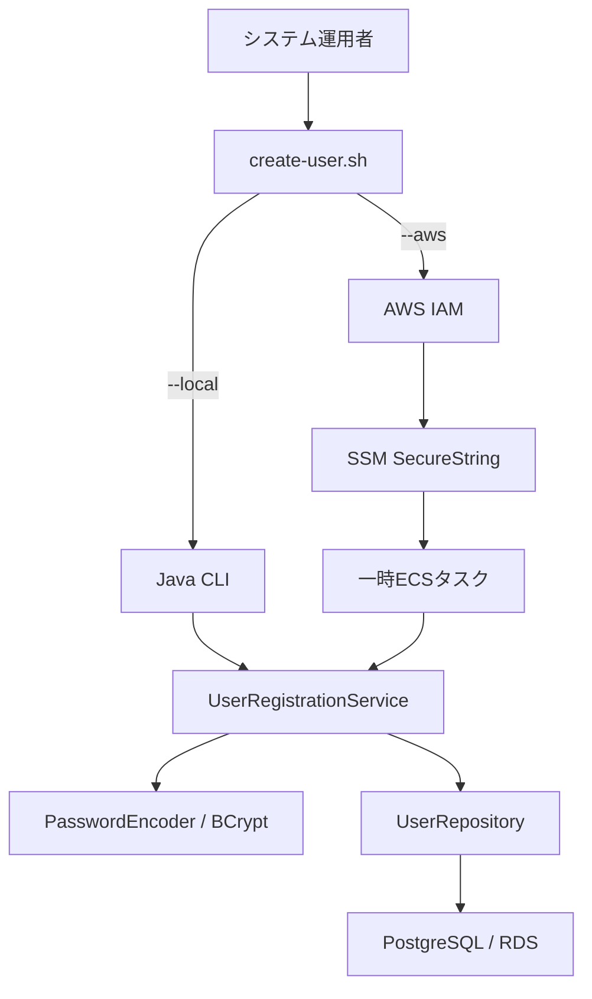
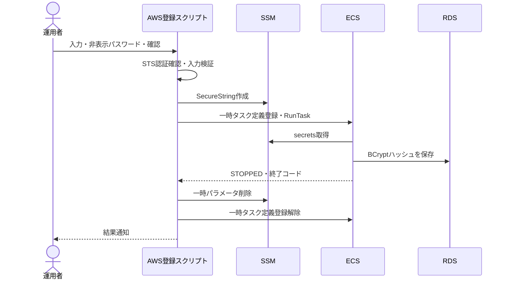

# 初期ユーザー登録スクリプト 詳細設計書

| 項目       | 内容                                      |
| ---------- | ----------------------------------------- |
| 対象Issue  | #146 初期ユーザー登録スクリプトを実装する |
| 作成日     | 2026-11-25                                |
| バージョン | 1.0                                       |
| ステータス | Approved Design（実装着手承認済み）       |

## 1. 目的・基本方針

システム運用者がローカル環境およびAWS環境で安全に初期ユーザーを登録できる仕組みを構築する。OP-001〜OP-005に対応する。

- 既存User Entity、UserRepository、認証処理を再利用する。
- ADMIN・INSPECTORのみ登録可能とする。
- 公開API、登録画面を設けない。
- BCryptでパスワードを一方向ハッシュ化する。
- OS・DB・IAMの権限によって運用者の操作を保護する。
- テストユーザーの自動登録を開発環境に限定する（方針確定済み）。
- 既存Webアプリケーションの動作を維持する。

## 2. システム構成



AWS側は一時ECSタスクとSSM SecureStringを採用する。既存Webサービスとは独立して実行する。

## 3. ファイル構成

### 新規作成予定

```text
scripts/user/create-user.sh
scripts/user/create-user-aws.sh
docs/operations/user-registration.md
src/main/java/com/mae134/equipmentinspection/
├── user/
│   ├── UserRegistrationCommand.java
│   └── UserRegistrationService.java
└── config/PasswordEncoderConfig.java
src/main/resources/
├── application-dev.properties
├── application-user-registration.properties
└── data-dev.sql
src/test/java/com/mae134/equipmentinspection/user/
├── UserRegistrationServiceTest.java
└── UserRegistrationCommandTest.java
```

### 既存ファイル変更予定

| ファイル                                  | 変更内容                                                   |
| ----------------------------------------- | ---------------------------------------------------------- |
| EquipmentInspectionSystemApplication.java | 登録専用起動モード対応                                     |
| SecurityConfig.java                       | PasswordEncoder定義分離、登録モードでWeb設定を読み込まない |
| application.properties                    | 共通初期データ設定の整理                                   |
| data.sql                                  | テストユーザーINSERTの分離                                 |

User.java、UserRepository.java、CustomUserDetailsService.java、Dockerfile、pom.xmlは原則変更しない。Terraformは runtime/iam.tf の登録用SSM読み取り権限追加のみ対象とする。GitHub Actionsは対象外。既存 scripts/lib/aws-cli-json.sh を再利用する。ファイル名と配置は提案段階。

## 4. クラス・スクリプト設計

### 4.1 create-user.sh

登録処理のエントリーポイント。実行環境を明示する。

```bash
./scripts/user/create-user.sh --local
./scripts/user/create-user.sh --aws
./scripts/user/create-user.sh --help
```

`--aws` は create-user-aws.sh に処理を委譲する。引数なし・未知の引数・複数環境指定は拒否する。パスワードをコマンドライン引数で受け取らない。

### 4.2 UserRegistrationCommand

- 名前、メールアドレス、ロールの受付。
- パスワードと確認パスワードの非表示入力。
- 登録先・登録内容の確認。
- Service呼び出し、結果表示、終了コード返却。
- ローカルでは `System.console().readPassword()` を使用する案。コンソールが取得できなければ中止する。

AWSモードでは対話入力を行わず、専用環境変数 USER_REGISTRATION_PAYLOAD のJSONを読み取る。入力元を明示的に区別し、欠落時は失敗する。AWS側でもServiceで再検証する。通常起動では登録処理を実行しない。

### 4.3 UserRegistrationService

メソッド案：

```java
@Transactional
public void register(String name, String email, char[] password, String role)
```

処理順序：

1. 入力値検証。
2. `existsByEmail` による重複確認。
3. BCryptによるハッシュ化。
4. User Entity生成。
5. UserRepositoryによる保存。
6. トランザクションコミット後に成功を通知。

例外時はロールバックする。DBのUNIQUE制約を維持し、同時登録時の重複も防止する。

### 4.4 PasswordEncoderConfig

既存SecurityConfigのPasswordEncoder定義を分離する案。

```java
@Configuration
public class PasswordEncoderConfig {
  @Bean
  public PasswordEncoder passwordEncoder() {
    return new BCryptPasswordEncoder();
  }
}
```

Web認証とCLIで同じハッシュ方式を使用する。既存認証方式は変更しない。

### 4.5 create-user-aws.sh

AWS認証確認、非表示入力・確認入力、登録内容の確認、SSM登録、一時タスク定義登録、タスク起動・監視・後片付けを担当する。詳細は第9章。

## 5. 起動モード

| 項目                            | 通常起動       | 登録専用起動 |
| ------------------------------- | -------------- | ------------ |
| Webサーバー                     | 起動           | 起動しない   |
| Web Security設定                | 有効           | 読み込まない |
| UserRepository・PasswordEncoder | 有効           | 有効         |
| 初期データ登録                  | 環境設定に従う | 無効         |
| DBスキーマ自動変更              | 既存設定       | 無効         |
| 登録処理                        | なし           | 実行         |
| 処理完了後                      | 継続稼働       | 終了         |

application-user-registration.properties 案：

```properties
spring.main.web-application-type=none
spring.sql.init.mode=never
spring.jpa.hibernate.ddl-auto=none
spring.jpa.show-sql=false
```

Web Security設定はServlet Webアプリケーションの場合のみ有効にする方針とし、CLIは専用プロファイルで起動する。起動モードは非機密の引数で明示し、通常起動から登録処理を呼ばない。CLI設定は優先度の高い起動設定でも固定し、矛盾する設定では起動を拒否する。具体的なBean構成は実装時に検証する。登録専用モードで初期化設定が他プロファイルに上書きされないことも確認する。

## 6. 入力バリデーション

以下は承認前の提案値。

| 項目           | 必須 | 制約                            |
| -------------- | ---- | ------------------------------- |
| 名前           | Yes  | 1〜100文字                      |
| メールアドレス | Yes  | 最大255文字、メール形式         |
| パスワード     | Yes  | 最低12文字、UTF-8で最大72バイト |
| 確認パスワード | Yes  | パスワードと一致                |
| ロール         | Yes  | ADMIN / INSPECTORのみ           |

BCryptの入力長制限を考慮する。空白のみの必須入力は拒否する。メールアドレスは前後の空白を除去し、大文字小文字は既存の完全一致認証に合わせて維持する案とする。パスワードはトリムしない。入力配列は可能な範囲で消去する。

| 自動設定項目          | 値               |
| --------------------- | ---------------- |
| id                    | DB自動採番       |
| passwordHash          | BCryptハッシュ   |
| active                | true             |
| createdAt / updatedAt | 既存 @PrePersist |

## 7. CLI操作イメージ

```text
$ ./scripts/user/create-user.sh --local
=== User Registration ===
Environment: LOCAL
Name: 山田太郎
Email: yamada@example.com
Select role:
  1. ADMIN
  2. INSPECTOR
Role: 2
Password:
Confirm password:
=== Confirmation ===
Environment: LOCAL
Name: 山田太郎
Email: yamada@example.com
Role: INSPECTOR
Create this user? [y/N]: y
SUCCESS: User registered.
```

パスワード・ハッシュは確認画面やログに表示しない。

| 終了コード（案） | 意味                                                    |
| ---------------- | ------------------------------------------------------- |
| 0                | 正常終了                                                |
| 1                | 登録処理・システムエラー                                |
| 2                | 引数・入力値エラー                                      |
| 3                | キャンセル                                              |
| 4                | AWS登録結果不明または後片付け失敗（登録結果は別途通知） |

## 8. テストユーザーの環境分離

テストユーザーをdev限定にする方針は確定済み。以下のファイル分割は提案。

- data.sql：設備・点検項目のみ。
- data-dev.sql：開発用テストユーザーのみ。
- data-test.sql：自動テスト専用データ（既存維持）。

```properties
# application-dev.properties
spring.sql.init.data-locations=classpath:data.sql,classpath:data-dev.sql
```

| 環境           | data.sql | data-dev.sql | data-test.sql |
| -------------- | -------- | ------------ | ------------- |
| 開発（dev）    | Yes      | Yes          | No            |
| AWS（dev無効） | Yes      | No           | No            |
| 自動テスト     | No       | No           | Yes           |
| 登録専用起動   | No       | No           | No            |

既存RDSやスナップショット内のテストユーザーは自動登録停止だけでは消えない。公開前に別Issueで無効化・削除を実施する。復元時にも確認する。

## 9. AWS実行方式（採用方式確定・詳細レビュー前）

### 9.1 前提・現状

- 一時ECS Fargateタスク＋SSM SecureStringを採用する。必要最小限のIAM変更は承認済みで、Issue本文も更新済み。
- ECS Execは無効のまま、RDSは非公開。既存サービスは停止しない。
- terraform-executionプロファイルを使用し、STS GetCallerIdentityで想定アカウントと terraform-execution-role の引き受けを検証する。AdministratorAccessは確認済みだが、実際のRunTaskは未検証。
- ECS実行ロールはruntime復元時に利用可能であることを確認する。Task Roleは新設しない。GitHub Actionsは登録処理に関与させない。
- CLI対応済みのコンテナイメージとIAM変更がAWSに反映済みであることを実行前提とする。既存イメージを無条件に使わず、対象イメージのdigestを確認して固定する。旧イメージで通常Web起動してしまうことを防ぐ。

### 9.2 一時パラメータと入力契約

| 項目                 | 設計                                                                  |
| -------------------- | --------------------------------------------------------------------- |
| パス                 | `/equipment-inspection/prod/user-registration/<execution-id>/payload` |
| execution-id         | 実行ごとのUUID                                                        |
| 種別                 | SecureString（Standard、既存のSSM暗号化方式に合わせる）               |
| JSONフィールド       | name, email, role, password                                           |
| コンテナ内の受け取り | `USER_REGISTRATION_PAYLOAD`（ECS secrets）                            |
| 上書き               | 禁止                                                                  |
| サイズ               | UTF-8でStandardパラメータ上限4 KiB以内を検証                          |

確認パスワードは送信しない。JSONは標準入力から生成し、既存 aws_cli_with_secure_json を利用して権限を制限したtmpfs上の一時ファイル経由で送信する。秘密をjqの引数、AWS CLI引数、シェル履歴、標準出力に渡さない。xtrace、AWS CLI debug、環境変数ダンプを禁止する。一時ファイルは終了時に削除する。異常強制終了時は残存の可能性がある。

### 9.3 実行フロー



1. AWSアカウント、ロール、リージョン、対象クラスター・サービス・ネットワーク、CLI対応イメージを確認する。
2. 名前・メール・ロール・パスワードを入力し、確認入力と登録先確認を行う。拒否時はAWS書き込みを行わない。
3. UUIDを生成し、SecureStringを上書きなしで作成する。
4. 現行タスク定義の必要な設定（実行ロール、DB用secrets、ログ、Fargate設定）を再利用し、専用family `equipment-inspection-user-registration-<execution-id>` を登録する。対象コンテナのcommandを登録専用起動引数に置き換え、登録用secrets参照を追加する。Web用ヘルスチェック・ポート設定は不要。サービスのタスク定義は変更しない。
5. 既存サービスと同等のサブネット・SG・public IP設定で単発タスクを起動する。RunTaskのfailuresとタスクARNを確認し、UUIDをclient tokenとして使用する。
6. STOPPEDまで監視し、対象コンテナの終了コードと停止理由を確認する。DBコミット後の終了コード0のみ登録成功とする。
7. タスク終了を確認してから一時SSMパラメータを削除し、一時タスク定義を登録解除する。サービス更新・停止は行わない。
8. 登録結果と後片付け結果を区別して通知する。

### 9.4 IAM変更

変更対象は `terraform/runtime/iam.tf`。既存ECSタスク実行ロールのSSM読み取り許可に `arn:aws:ssm:ap-northeast-1:<account-id>:parameter/equipment-inspection/prod/user-registration/*` を追加する。既存のGetParameter/GetParametersと復号設定を利用し、DB用権限を維持する。作成・削除権限は追加しない。運用者・GitHub Actionsロールは変更しない。

既存実行ロールを共用するため、同ロールを使う他のタスク定義でも登録用パスを参照できる余地がある。専用ロール分離は対象外とし、短時間の保存・運用者権限・タスク定義管理でリスクを抑える。既存kms:Decryptの広い権限は別途レビューする。

### 9.5 異常終了・後片付け

| 事象                     | 対応                                               |
| ------------------------ | -------------------------------------------------- |
| 入力不正・キャンセル     | AWS書き込みなしで終了                              |
| SSM作成失敗              | タスク起動なし。作成結果不明なら固有パスを確認     |
| タスク定義登録・起動失敗 | 作成済みリソースを確認して後片付け                 |
| 起動応答消失             | client token・実行IDで照合し、安易に再起動しない   |
| DB登録失敗               | ロールバック、終了確認後に後片付け                 |
| Ctrl+C・タイムアウト     | 自分のタスクのみ停止し、STOPPED確認後に後片付け    |
| 停止確認不能             | 結果不明として残存識別子を通知し、手動確認へ       |
| 後片付け失敗             | 登録結果とは別に警告・非ゼロ終了、残存識別子を通知 |
| 強制終了・電源断         | 手動復旧手順で対応                                 |

EXIT/INT/TERMのtrapで後片付けを試みる。実行ID、パラメータ名、タスク定義ARN、タスクARNのみを復旧用に通知し、秘密は出力しない。監視上限は15分、停止確認上限は5分を提案する。登録結果不明時は再実行前にDB上の登録状況を確認する。停止しても既にコミット済みの登録は取り消されない。タスク定義の登録解除は履歴の完全削除ではないため、定義には秘密を含めない。

### 9.6 運用上の制約

SSMは保存時暗号化されるが、ECS secretsで注入された値はコンテナ内では平文の環境変数となる。ログ・例外・診断出力への露出を防ぐ。Javaでは環境変数自体の完全消去は保証できないため、短命タスクとして終了させる。自動期限切れ削除基盤は追加しない。既存DB用SSMパスは流用しない。AWS実機検証が完了するまでIssue全体を完了扱いにしない。

## 10. セキュリティ設計

| 対策                           | 方針                                                |
| ------------------------------ | --------------------------------------------------- |
| 平文保存防止                   | BCrypt、ソース・スクリプト・Gitへの機密情報保存禁止 |
| 入力時露出防止                 | 非表示入力                                          |
| コマンド履歴対策               | パスワード引数禁止                                  |
| ログ対策                       | パスワード・ハッシュ非出力                          |
| 重複防止                       | RepositoryとDB UNIQUE制約                           |
| 不完全登録防止                 | トランザクション                                    |
| Webからの不正登録防止          | 公開APIなし                                         |
| AWS操作制御                    | IAM認証・認可                                       |
| 誤登録防止                     | 環境明示と確認                                      |
| 本番へのテストユーザー登録防止 | Spring Profiles                                     |

アプリケーションのADMIN・INSPECTORにアカウント管理権限を付与しない。ファイル実行権限だけを認可の根拠としない。

## 11. テスト計画（未実施）

### 正常系

- [ ] ADMIN登録
- [ ] INSPECTOR登録
- [ ] active=true
- [ ] BCryptハッシュ保存
- [ ] 登録ユーザーでログイン

### 異常系

- [ ] 名前未入力拒否
- [ ] メールアドレス未入力拒否
- [ ] 不正メール形式拒否
- [ ] 不正ロール拒否
- [ ] パスワード未入力拒否
- [ ] パスワード長制約違反拒否
- [ ] 確認パスワード不一致拒否
- [ ] 重複メールアドレス拒否
- [ ] DBエラー時に不完全な登録が残らない

### 環境・セキュリティ

- [ ] 登録専用起動時にWebサーバーが起動しない
- [ ] 登録専用起動時に初期データが登録されない
- [ ] 開発環境でテストユーザーが登録される
- [ ] 本番環境でテストユーザーが登録されない
- [ ] パスワードがログ・引数に出力されない
- [ ] AWS上で安全にユーザー登録できる
- [ ] 既存テストがすべて成功する

### AWS・運用検証（追加）

- [ ] 想定外のAWSアカウント・ロールを拒否する
- [ ] 一時パラメータがSecureStringであり、固有パス・上書き禁止である
- [ ] タスク定義・CLI引数・ログに平文やハッシュがない
- [ ] ADMIN・INSPECTORをAWSで登録しログインできる
- [ ] AWSで不正入力・重複登録を拒否する
- [ ] 既存サービスを停止・更新しない
- [ ] 正常終了時にパラメータ削除・タスク定義登録解除が行われる
- [ ] 起動失敗・DBエラー・中断・タイムアウト時の後片付けを確認する
- [ ] 結果不明・後片付け失敗時に識別子を通知する
- [ ] IAM変更が専用パスの読み取り追加に限定される
- [ ] Terraform fmt・validateが成功する
- [ ] 登録専用起動時にDBスキーマが変更されない
- [ ] AWSでdev用ユーザーが新規自動登録されない（既存行とは区別）
- [ ] 既存自動テスト用データが維持される

ローカル・AWS実行手順、実際の検証結果を運用ドキュメントに残す。

## 12. 対象外

- アカウント削除・無効化・再有効化
- パスワード変更・リセット、ロール変更
- ADMINからMANAGERへの名称変更
- ユーザー管理画面、公開サインアップ
- ログイン・ログアウト・セッション・既存認可仕様の変更
- メール招待・検証、MFA、IAMユーザー管理
- 登録用SSM読み取り権限追加と一時リソース作成・削除以外のAWSインフラ変更
- 専用IAMロール新設・既存権限体系全体の見直し・ECS Exec有効化・踏み台新設
- 自動クリーンアップ基盤・CI/CD変更
- 既存RDS・スナップショット内のテストユーザー削除・無効化

## 13. 設計レビュー・承認

| 項目                                | 状態             |
| ----------------------------------- | ---------------- |
| ADMIN・INSPECTORで先行実装          | 方針確定         |
| テストユーザーdev限定               | 方針確定         |
| 基本構成・ファイル・クラス設計      | 提案済み         |
| ローカル実行方式                    | 提案済み         |
| 入力制約・終了コード                | 提案済み         |
| セキュリティ・テスト設計            | 提案済み         |
| AWS実行方式                         | 承認済み         |
| 必要最小限のIAM変更                 | 承認済み         |
| Issue本文更新                       | ユーザー反映済み |
| AWS詳細設計・入力契約・タイムアウト | 提案済み         |
| 人間による最終承認                  | 未実施           |

AWS方式は決定済み。詳細設計のレビューと明示的な承認を経てApproved Designへ更新する。その後Codex向け実装指示を作成する。Issue本文はユーザーが更新済み。コード・AWSリソースへの変更は未実施。
